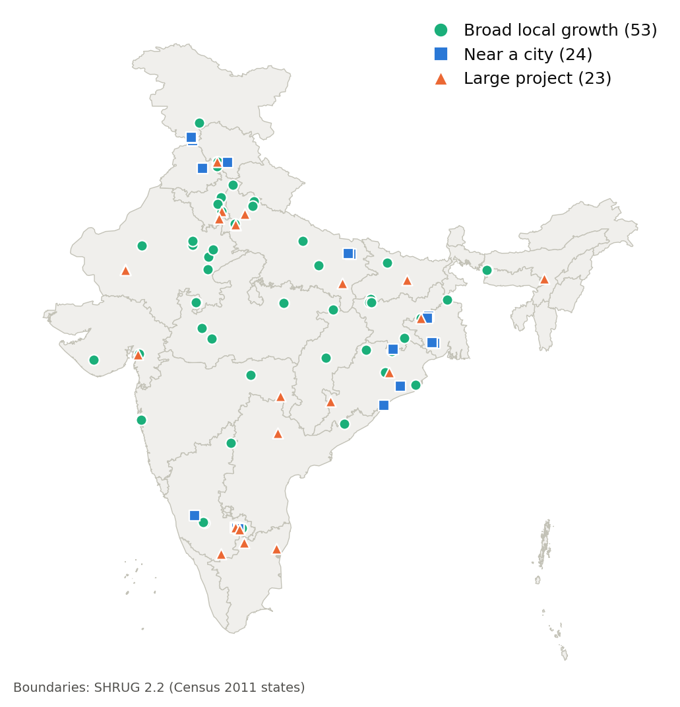

# Village Economic Growth Intelligence

Identifies the **top 100 villages in India with the highest economic growth over the last five years (2020–2025)** using satellite night-time lights, 10 m land cover and Census 2011 village boundaries.



## Definition of economic growth

A sustained rise in economic **activity** (night-time lights) together with new physical **capital** (persistent new built-up area), measured against each village's own starting point. A village must show both to be ranked.

## Data sources

| Dataset | Use | Resolution / years | Source |
| --- | --- | --- | --- |
| SHRUG 2.2 open polygons (Development Data Lab) | Census 2011 village, district and state boundaries | Vector, Census 2011 | https://www.devdatalab.org/shrug_download/ (CC BY-NC-SA 4.0) |
| Esri 10 m Annual Land Use Land Cover (Impact Observatory / Esri) | Built-up and cropland area per village | 10 m; 2020, 2024, 2025 | GEE `projects/sat-io/open-datasets/landcover/ESRI_Global-LULC_10m_TS` ([catalog](https://gee-community-catalog.org/projects/S2TSLULC/)) |
| VIIRS DNB monthly composites, VCMSLCFG (Earth Observation Group, Colorado School of Mines) | Night-time radiance per village | ~464 m; monthly 2020–2025 | GEE `NOAA/VIIRS/DNB/MONTHLY_V1/VCMSLCFG` ([catalog](https://developers.google.com/earth-engine/datasets/catalog/NOAA_VIIRS_DNB_MONTHLY_V1_VCMSLCFG)) |

**Why these.** SHRUG is the only open all-India village boundary set and links to Census codes. Esri LULC is a consistent annual 10 m series from one model, fine enough to see village-scale construction. VIIRS is the standard proxy for economic activity, and the monthly product covers 2025 in full (the official annual product stops at 2024).

## Method

1. **Prepare boundaries** – attach state and district names, drop 506 non-village gaps, build a unique ID (`state_district_subdistrict_village`), flag 4,168 towns, simplify boundaries by ~11 m.
2. **Extract in Google Earth Engine** – per village: land-cover class areas for 2020 and 2025; *new built-up* = not built in 2020 and built in **both** 2024 and 2025; annual night light (median of months with ≥ 2 cloud-free observations, values < 0.5 nW/cm²/sr set to 0) for 2020–2025. Polygons are sent from the local file in 3,242 batches of 200.
3. **Score** – 639,782 eligible villages (towns, fragments < 10 ha and villages with missing land cover excluded) are scored on four signals, each converted to a 0–100 percentile:

   | Signal | Formula | Weight |
   | --- | --- | --- |
   | Night-light trend | Theil-Sen slope of ln(1 + total light), 2021–2025 | 0.30 |
   | Night-light gain | (mean total light 2024–25 − 2021) per km² | 0.20 |
   | New built-up share | new built-up ha / village area ha | 0.25 |
   | Settlement expansion | new built-up ha / (2020 built-up ha + 1) | 0.25 |

   Score = weighted mean of the percentiles. A village is ranked only if a night-light signal **and** a built-up signal are both ≥ 80th percentile (72,861 villages pass). 2021 is the night-light baseline because the 2020 COVID lockdown depressed lights nationwide.
4. **Rank and check** – one top-100 list. Each village carries `peri_urban` (within 10 km of one of the 500 brightest towns) and `flag_large_project` (change too large or abrupt for organic growth, e.g. an airport or refinery). Rank stability is tested over 1,000 random weight sets.

## Key findings

- Across all villages, built-up area grew **19%** and total night light **57%** between 2020 and 2025.
- The top 100 span **18 states**, led by Karnataka (16), Uttar Pradesh (13), Odisha (10) and West Bengal (9).
- **53** show broad local growth, **24** sit near a major city and **23** are driven by a single large project.
- Median rank stability is **67%**: the median top-100 village stays in the top 100 under two-thirds of random weightings.

## Repository structure

```
scripts/
  00_add_admin_names.py      attach state/district names to village polygons
  01_prepare_gee_upload.py   clean, key, flag towns, simplify
  02_extract_gee.py          per-village land cover + night lights in Google Earth Engine
  03_score_villages.py       exclusions, signals, scoring, ranking, flags
  04_visualise.py            static and interactive maps of the top 100
  05_build_presentation.py   builds the slide deck from the outputs
data/output/
  top100_villages.csv        final ranked top 100 with scores and attributes
  villages_scored.csv.gz     all 648,372 polygons with signals, score, flags
  top100_map.png             static map
  top100_map.html            interactive map (open in a browser)
presentation/
  Village_Economic_Growth_Top100.pptx
docs/
  Technical_Documentation.pdf
```

## How to run

Requirements: Python 3.11+ (`pip install -r requirements.txt`), and a Google Cloud project registered for Earth Engine (`earthengine authenticate` once).

1. Download the SHRUG PC11 village, district and state polygon shapefiles from the [SHRUG download page](https://www.devdatalab.org/shrug_download/) and unzip them into `data/raw/shrug_pc11_village/`, `data/raw/shrug_pc11_district/` and `data/raw/shrug_pc11_state/`.
2. Run from the repository root:

```bash
python scripts/00_add_admin_names.py
python scripts/01_prepare_gee_upload.py
python scripts/02_extract_gee.py --project <gcp-project-id> --test 10   # optional quick check
python scripts/02_extract_gee.py --project <gcp-project-id>             # ~2.5 h, resumable
python scripts/03_score_villages.py
python scripts/04_visualise.py
python scripts/05_build_presentation.py
```

`02_extract_gee.py` saves each batch as it finishes, so it can be stopped and restarted. If the project hits its Earth Engine quota, add `--workers 2`. All scoring choices (years, weights, thresholds) are constants at the top of `03_score_villages.py`. Raw and intermediate data (`data/raw`, `data/interim`, ~5 GB) are not committed; the scripts recreate them.

## Output columns (`top100_villages.csv`)

| Column | Meaning |
| --- | --- |
| `rank`, `score`, `rank_stability` | Final rank, composite score (0–100), % of 1,000 random weightings keeping the village in the top 100 |
| `tv_name`, `dist_name`, `state_name`, `uid`, `pc11_tv_id`, `lat`, `lon` | Village identity and location |
| `area_ha`, `built_2020`, `built_2025`, `new_built_ha`, `crop_to_built_ha` | Land cover (hectares) |
| `ntl_base`, `ntl_end`, `ntl_trend`, `ntl_gain_per_km2` | Night light 2021, mean 2024–25, trend, gain |
| `built_share_new`, `built_expansion`, `p_*` | Built-up signals and the four signal percentiles |
| `dist_major_town_km`, `peri_urban` | Distance to nearest major town; within 10 km |
| `flag_large_project`, `flag_crop_loss`, `flag_bare_gain`, `flag_water_change` | Review flags |

## Limitations

- Lights and buildings are proxies for income; farm-led growth is under-ranked.
- City spillover and large single projects count as growth; they are flagged, not removed.
- Census 2011 boundaries carry ~0–1 km error; villages absorbed into cities since 2011 still appear as villages.
- At ~464 m, night lights cover about 20 pixels per village; dim rural lights sit close to the noise floor.
- Weights and thresholds are judgement calls; rank stability quantifies their effect.
- The ranking has not yet been validated against imagery or survey data.

## Citation

Asher, S., Lunt, T., Matsuura, R., Novosad, P. (2021). Development research at high geographic resolution: an analysis of night-lights, firms, and poverty in India using the SHRUG open data platform. *World Bank Economic Review*.
Karra, K. et al. (2021). Global land use / land cover with Sentinel-2 and deep learning. *IGARSS 2021*.
Elvidge, C. D. et al. (2021). Annual time series of global VIIRS nighttime lights derived from monthly averages: 2012 to 2019. *Remote Sensing*, 13(5), 922.
